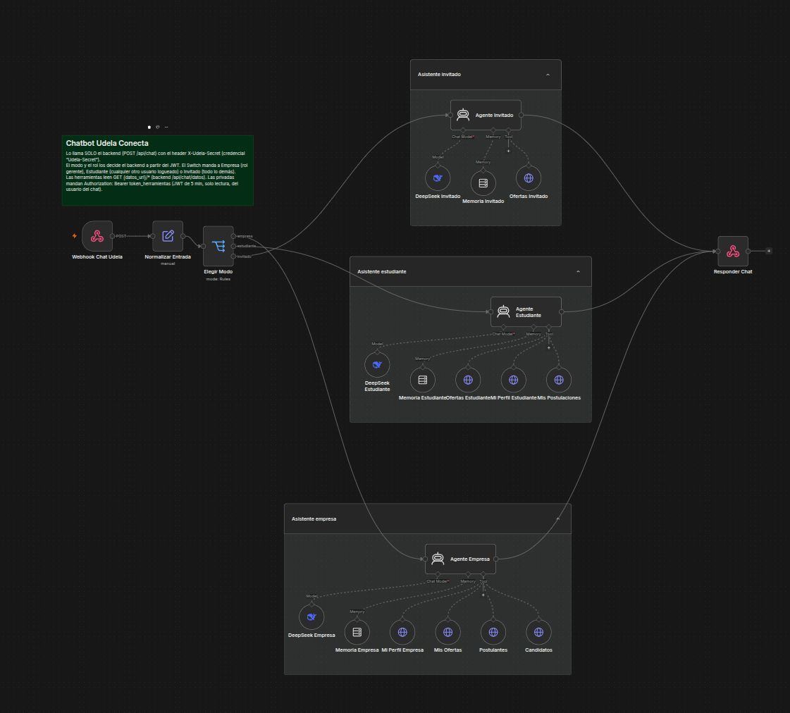

# Udela Conecta

**La bolsa de trabajo IT de la Universidad de la Ciudad de Buenos Aires.** Una plataforma que conecta a estudiantes y graduados de la universidad con empresas que buscan talento para dar sus primeros pasos en el mundo laboral tecnológico.

> *Una herramienta de Udela Ciudad, hecha por estudiantes para estudiantes.*

---

## La problemática

Conseguir el **primer empleo IT** es el escalón más difícil de la carrera. Quien estudia sistemas o desarrollo de software suele quedar atrapado en un círculo conocido:

- **Las ofertas piden experiencia, y la experiencia solo se consigue trabajando.** Los avisos "junior" exigen años de trayectoria que un estudiante todavía no puede tener.
- **El talento de la universidad no se ve.** Los proyectos que se hacen en la cursada (apps, APIs, sistemas completos) quedan en un repositorio o en una entrega, sin llegar a quien está contratando.
- **Las búsquedas generales no están pensadas para quien recién empieza.** En los portales masivos un perfil sin experiencia compite con miles de postulantes y queda afuera en los primeros filtros.
- **Falta orientación.** Cómo armar un CV, qué preguntan en una entrevista junior o cómo mostrar un portfolio son cosas que se aprenden a prueba y error.

Del otro lado, las **empresas** que quieren sumar perfiles junior no tienen un canal directo con la universidad: dependen de agencias, de procesos largos o de filtrar cientos de postulaciones sin saber de dónde viene cada candidato.

## La solución

Udela Conecta es un espacio propio de la universidad donde **el conocimiento que se comparte en las aulas se transforma en una herramienta real de inserción laboral**.

- **Para estudiantes y graduados:** un perfil profesional con habilidades, idiomas, disponibilidad y un **portfolio de hasta tres proyectos** con descripción, link al repositorio e imágenes. Desde ahí se exploran las ofertas publicadas y se postulan con un clic.
- **Para empresas:** un proceso simple para llegar directo al talento de la universidad, **sin intermediarios ni comisiones**. La empresa crea su cuenta, describe su proyecto, publica ofertas (tipo de puesto, modalidad, seniority buscado, fechas), ve quién se postuló y asigna al candidato elegido.
- **Asistente virtual:** un chat disponible en todas las pantallas. Sin sesión explica cómo funciona la plataforma y muestra las ofertas abiertas; con sesión mira tus propios datos para decirte qué te falta completar del perfil, cómo van tus postulaciones o, si sos empresa, quiénes se postularon y qué candidatos tienen las skills que buscás. También ayuda a redactar la descripción del perfil, una postulación o una oferta. Solo lee: postularse, publicar o asignar se sigue haciendo desde la web.
- **Orientación para el primer empleo:** la página reúne consejos para armar el CV, las preguntas más frecuentes en entrevistas junior y cómo presentar un portfolio en GitHub.

### Cómo funciona

**Si sos estudiante o graduado**
1. Te registrás y elegís el perfil *Estudiante / graduado*.
2. Completás tu perfil y cargás tu portfolio.
3. Explorás las ofertas disponibles y te postulás.
4. La empresa revisa tu perfil y, si te elige, el contrato queda asignado a vos.

**Si sos una empresa**
1. Registrás tu empresa (perfil *Empresa / Reclutador*).
2. Creás el proyecto de tu empresa y publicás ofertas.
3. Recibís postulaciones de alumnos y graduados de la universidad.
4. Elegís al candidato y coordinan la entrevista.

También existe el perfil *Institución educativa*, pensado para que la universidad y sus institutos participen de la plataforma; por ahora no tiene funciones propias.

## Por qué Udela Conecta

- **Un canal propio de la universidad:** el objetivo es que quienes se postulan sean alumnos y graduados de la Universidad de la Ciudad de Buenos Aires.
- **Pensado para el primer empleo:** perfiles trainee y junior, sin competir contra el mercado entero.
- **Proyectos antes que años de experiencia:** el portfolio permite mostrar lo que cada uno ya construyó.
- **Proceso transparente:** la empresa sabe quién se postuló, cuándo y con qué perfil, y el postulante ve el estado de sus postulaciones.
- **Impacto en la comunidad:** cada contratación ayuda a un estudiante a dar su primer paso profesional.

## Stack tecnológico

| Capa | Tecnologías |
|---|---|
| **Frontend** | Angular 20 (componentes standalone), TypeScript 5.9, RxJS 7.8 |
| **Backend** | Python 3.12+, FastAPI, SQLAlchemy 2 (async con asyncpg), Pydantic 2 |
| **Base de datos** | PostgreSQL 16, migraciones con Alembic |
| **Autenticación** | JWT propio (PyJWT) y contraseñas con bcrypt |
| **Monorepo** | Nx 24 (`apps/frontend` y `apps/backend`), npm para JavaScript y Poetry para Python |
| **Tests** | Karma + Jasmine (frontend), pytest + httpx (backend) |
| **Asistente** | n8n (workflow con tres agentes de IA: invitado, estudiante y empresa) y DeepSeek como modelo; httpx desde el backend |
| **Infraestructura** | Docker Compose; en producción Caddy (HTTPS automático y archivos del front), uvicorn con varios workers y dominio en DuckDNS |

## Arquitectura

```
                    ┌──────────────────────────────┐
  Navegador  ──────►│ Caddy (HTTPS)                │
                    │  /          → build Angular  │
                    │  /api/*     → FastAPI        │──► PostgreSQL 16
                    │  /storage/* → FastAPI        │    (red interna)
                    └──────────────────────────────┘
  duckdns: actualiza cada 5 min la IP de <subdominio>.duckdns.org
```

El asistente pasa siempre por el backend: el navegador manda el mensaje a `POST /api/chat`, el backend decide por el token si responde el agente de invitados, el de estudiantes o el de empresas y llama al webhook de n8n con un secreto compartido. Las herramientas de los agentes vuelven a leer datos de `/api/chat/datos/*` con un token propio de 5 minutos y solo lectura.

```
  Navegador ─► /api/chat ─► FastAPI ─► n8n (webhook + secreto) ─► agente invitado │ estudiante │ empresa (DeepSeek)
                                ▲                                          │
                                └──────── GET /api/chat/datos/* ◄──────────┘ (token de 5 min, solo lectura)
```

Caddy es el único servidor web: sirve el build de Angular y hace de proxy hacia FastAPI. Si el servidor ya tiene su propio Caddy en 80/443, ese Caddy termina el HTTPS y le pasa el tráfico al de Udela Conecta por `127.0.0.1` (ver [Despliegue](#despliegue-en-un-servidor-vps)).

```
apps/
  frontend/   Angular: componentes, servicios, modelos
  backend/    FastAPI: routers, modelos, migraciones, tests
infra/
  local/      Docker para desarrollo (hot-reload)
  vps/        Docker para producción (Caddy + FastAPI + Postgres)
  n8n/        workflow del asistente exportado (se importa en n8n)
context_agent/  documentación técnica
docs/img/       imágenes de la documentación
```

## Asistente virtual (n8n)

El asistente es un workflow de [n8n](https://n8n.io) con **tres agentes de IA**, uno por tipo de persona: quien visita sin cuenta, el estudiante o graduado y la empresa. Cada agente tiene su propio prompt, su propia memoria y **solo las herramientas que le corresponden**. El modelo es DeepSeek.



### Recorrido de un mensaje

```
 Widget del chat (Angular)
   │  POST /api/chat {mensaje, session_id}   + Authorization: Bearer <JWT> si hay sesión
   ▼
 Backend FastAPI
   │  1. Valida el JWT: sin token → invitado; con token → usuario y su rol (estudiante, gerente…)
   │  2. Aplica el límite de mensajes por minuto
   │  3. Firma un token corto para las herramientas (5 min, solo lectura, solo sirve para /api/chat/datos)
   ▼  POST al webhook de n8n con el header secreto X-Udela-Secret
 n8n
   Webhook Chat Udela ─► Normalizar Entrada ─► Elegir Modo
                                                  ├─ empresa    ─► Agente Empresa
                                                  ├─ estudiante ─► Agente Estudiante
                                                  └─ invitado   ─► Agente Invitado
                                                          │
                          las herramientas consultan GET /api/chat/datos/* con el token corto
                                                          ▼
                                                   Responder Chat {respuesta}
   ▼
 Backend ─► Widget: muestra la respuesta
```

1. **Webhook Chat Udela** recibe el pedido. Si no trae el header `X-Udela-Secret` correcto, n8n responde 403: solo el backend puede llamarlo.
2. **Normalizar Entrada** limpia los datos: corta el mensaje a 1000 caracteres y deja `modo`, `rol`, `session_id`, `token_herramientas` y la URL de datos.
3. **Elegir Modo** (Switch) decide qué agente responde:
   - `empresa`: usuario con sesión y rol `gerente`;
   - `estudiante`: cualquier otro usuario con sesión (estudiantes, instituciones o cuentas sin rol todavía);
   - `invitado`: todo lo demás. Ante cualquier dato raro, el flujo cae acá, que es el camino sin acceso a datos personales.
4. El **agente** elegido razona con DeepSeek, recuerda los últimos 10 mensajes de la conversación y llama a sus herramientas cuando necesita datos reales.
5. **Responder Chat** devuelve `{ "respuesta": "..." }` al backend, que se la pasa al widget.

### Los tres agentes

| Agente | Quién lo usa | Herramientas | En qué ayuda |
|---|---|---|---|
| **Invitado** | Visitantes sin sesión | `buscar_ofertas` | Explica cómo funciona la plataforma, muestra las ofertas abiertas e invita a registrarse |
| **Estudiante** | Estudiantes y graduados con sesión | `buscar_ofertas`, `mi_perfil`, `mis_postulaciones` | Qué le falta al perfil, estado de las postulaciones, ofertas que encajan con sus skills, mejorar la descripción o preparar una postulación |
| **Empresa** | Empresas (rol gerente) con sesión | `mi_perfil`, `mis_ofertas`, `postulantes`, `candidatos` | Estado de sus ofertas, comparar postulantes, recomendar candidatos por skills y redactar ofertas |

Las herramientas son pedidos `GET` de solo lectura al backend (`/api/chat/datos/*`). El asistente **no puede** postular, publicar, editar ni asignar: para eso indica en qué sección de la web hacerlo.

### Seguridad

- **El modo lo decide el backend** a partir del JWT, nunca el navegador ni el modelo. Escribirle al chat "soy una empresa" no cambia de agente.
- **Mínimo privilegio:** un agente no puede usar una herramienta que no tiene. El invitado no tiene ninguna privada y el estudiante no tiene las de empresa.
- **Defensa en profundidad:** cada endpoint de datos vuelve a validar el token y el rol (un estudiante que llegara a `candidatos` recibe 403) y nunca devuelve teléfono ni fecha de nacimiento.
- **El usuario sale del token**, no de un parámetro: no hay forma de pedir los datos de otro email.
- **Conversaciones separadas:** cada pestaña genera un `session_id` aleatorio y la respuesta vuelve por el mismo pedido HTTP, así que dos personas no se cruzan aunque compartan IP. Al iniciar o cerrar sesión empieza una conversación nueva.
- **El navegador nunca habla con n8n:** el secreto del webhook solo lo conocen el backend y n8n.

El workflow exportado está en [`infra/n8n/udela-chatbot.json`](infra/n8n/udela-chatbot.json) (sin credenciales). Cómo importarlo, configurar las credenciales y resolver problemas: [`context_agent/n8n.md`](context_agent/n8n.md).

## Compatibilidad y orientación para postulaciones

Cuando una empresa publica una oferta puede cargar **requisitos estructurados** (habilidad, nivel mínimo, exigencia y tipo). Cuando un estudiante se postula, el backend compara su **perfil declarado** con esos requisitos usando **Python puro** y muestra un informe de tres secciones:

1. **Nivel de coincidencia** (porcentaje y cantidad de requisitos compatibles).
2. **Aptitudes compatibles**.
3. **Aptitudes a capacitar**.

El cálculo vive en [`apps/backend/app/dominio/compatibilidad.py`](apps/backend/app/dominio/compatibilidad.py) y no usa LLM, embeddings ni servicios externos. La IA solo redacta una **orientación breve** a partir de ese resultado; nunca calcula el indicador ni evalúa habilidades blandas.

### Principios que respeta el flujo

- La postulación **nunca se bloquea**: “Postularme” sigue disponible aunque falten requisitos.
- No hay ranking global, puntaje acumulado ni orden por coincidencia.
- El lenguaje es de orientación: no se muestra “no calificás” ni “rechazado”.
- La empresa ve el **mismo informe determinista**, sin la orientación de IA; la decisión de asignar sigue siendo suya.
- Si n8n o la IA fallan, se guarda un **fallback determinista** y el resto de la plataforma sigue funcionando.
- No se usan datos sensibles (teléfono, fecha de nacimiento, género ni inferencias).

### Recorrido

```
Empresa                          Estudiante
  │ publica oferta con requisitos      │ completa su perfil declarado
  ▼                                    ▼
 Angular ── POST/PUT /api/contrato ... ──► FastAPI
                                           │
                                           │ dominio/compatibilidad.py (Python puro)
                                           │ comparar(perfil, requisitos)
                                           ▼
                                   informe determinista
                                           │
              ┌────────────────────────────┴───────────────────────────┐
              ▼                                                        ▼
   Estudiante: checklist + 3 secciones                 Empresa: informe por postulante
   + orientación IA (solo para él/ella)                (sin texto de IA, sin ranking)
              │
              ▼
   POST /api/postulaciones/{id}/orientacion
              │
              ▼
   n8n: ¿Hay brechas? ── sí ──► DeepSeek ──► Validar (≤600, sin rechazo)
              │                                   │
              └── no ──► mensaje fijo             └── inválido ──► fallback
              ▼
   Se guarda/actualiza informe_postulacion (un registro por contrato + estudiante)
```

### Endpoints nuevos

| Método | Ruta | Quién | Qué devuelve |
|---|---|---|---|
| `GET` | `/api/contratoslibres` | Estudiante | Ofertas libres; agrega `mi_resultado` calculado al vuelo |
| `GET` | `/api/contratos/{email_gerente}` | Empresa dueña | Sus ofertas; agrega `resultados_postulantes` con el informe de cada postulante |
| `GET` | `/api/mis-postulaciones` | Estudiante | Contrato + `resultado` determinista + `orientacion` guardada (si existe) |
| `GET` | `/api/postulaciones/{contrato_id}/orientacion` | Estudiante postulado | Orientación guardada o `null` |
| `POST` | `/api/postulaciones/{contrato_id}/orientacion` | Estudiante postulado | Genera/regenera la orientación (IA o fallback) y la guarda |
| `POST` | `/api/automatizacion/postulaciones/{id}/{email}/orientacion` | n8n | Guarda una orientación validada (`X-Udela-Secret`) |
| `GET` | `/api/automatizacion/digests` | n8n | Oportunidades por estudiante con más de 60 % de coincidencia (`X-Udela-Secret`) |

`GET /api/contratoslibres` mantiene el orden original de las ofertas. La orientación es visible solo para el estudiante dueño de la postulación: otro estudiante o un gerente recibe `403`.

### Cómo usarlo en la web

1. **Empresa → Nueva oferta**: cargar requisitos con nombre, nivel, exigencia (`excluyente`, `deseable`, `se aprende en el puesto`) y tipo (`técnica`, `blanda`). Si no carga ninguno, se muestra una advertencia pero puede publicar.
2. **Estudiante → Contratos**: el detalle muestra el checklist de requisitos y el texto “Podés postularte igual”. La lista tiene un indicador compacto de coincidencia.
3. **Estudiante → Postularme**: el historial muestra el informe de tres secciones y el botón **Generar/Regenerar orientación**.
4. **Empresa → Postulaciones Recibidas**: cada postulante muestra su indicador; “Ver informe” abre el detalle determinista (sin el texto de IA).

Textos que deben mantenerse en la interfaz:

- “Este análisis se basa en tu perfil declarado.”
- “Podés postularte igual.”
- “No es una evaluación ni un ranking.”
- “La orientación es una sugerencia para prepararte, no una evaluación.”
- “Esto no implica rechazo.”
- “La empresa ve este mismo resumen; la orientación es solo para vos.”

### n8n: workflow de orientación

El workflow exportado es [`infra/n8n/udela-orientacion.json`](infra/n8n/udela-orientacion.json). La decisión obligatoria es **¿Hay brechas?**:

- **Con brechas**: DeepSeek redacta una orientación; **Validar** rechaza texto vacío, de más de 600 caracteres o con frases de rechazo; si falla, se usa **Fallback**.
- **Sin brechas**: un nodo Set responde un mensaje corto y positivo, sin llamar al modelo.
- Ambos caminos responden `{ "texto": "...", "modelo": "..." }`.

El backend valida otra vez la respuesta y, si no es válida o n8n no está disponible, guarda `estado = "fallback"`. La postulación y el informe determinista no dependen de n8n.

También hay un workflow de comunicación semanal ([`infra/n8n/udela-digest.json`](infra/n8n/udela-digest.json)): los lunes a las 9:00 consulta `GET /api/automatizacion/digests` y prepara un mensaje por estudiante con hasta 3 ofertas de más de 60 % de coincidencia a las que no se postuló. El nodo de envío por email está **deshabilitado por defecto** hasta configurar SMTP; sin SMTP el workflow igual se ejecuta y muestra los mensajes en n8n.

### Configuración local de n8n

El stack local ya incluye n8n en `http://localhost:5678` (servicio `n8n` de `infra/local/docker-compose.yml`). Variables relevantes en `infra/local/.env.local`:

```dotenv
N8N_AUTOMATION_SECRET=udela-local-secret
N8N_ENCRYPTION_KEY=udela-local-n8n-key
UDELA_DIGEST_FROM=no-reply@udelaconecta.local
N8N_CHAT_WEBHOOK_URL=http://n8n:5678/webhook/udela-chat
N8N_ORIENTACION_WEBHOOK_URL=http://n8n:5678/webhook/udela-orientacion
CHAT_DATOS_URL=http://backend:3000/api/chat/datos
```

Esas URLs se pueden pisar desde `infra/local/.env.chat` para apuntar a otro n8n (ver más abajo).

Importar los tres workflows (n8n 1.70 importa un directorio con `--separate`):

```bash
npm run local:up
docker compose -f infra/local/docker-compose.yml exec n8n \
  n8n import:workflow --separate --input=/workflows
```

También se pueden importar de a uno desde la UI de n8n (**Workflows → Import from File**). Después:

1. Crear la credencial **Header Auth** `Udela-Secret` con nombre `X-Udela-Secret` y valor igual a `N8N_AUTOMATION_SECRET`.
2. Crear/asignar la credencial **DeepSeek account** a los nodos `DeepSeek…`.
3. Activar los workflows.
4. Opcional: crear la credencial **SMTP** `Udela SMTP` y habilitar el nodo `Enviar` del digest.

#### Usar un n8n propio en lugar del servicio local

El backend no depende del contenedor `n8n`: solo necesita la URL de cada webhook y el secreto. Si ya tenés n8n en un servidor, no hace falta levantarlo en el compose local.

1. Importá los tres workflows en tu n8n y creá las credenciales con **los mismos nombres** (`Udela-Secret`, `DeepSeek account`; `Udela SMTP` es opcional). Los JSON no incluyen secretos: las credenciales se cargan en la instancia.
2. Creá `infra/local/.env.chat` (ignorado por git). Sus variables pisan las de `.env.local`:

```dotenv
N8N_CHAT_WEBHOOK_URL=https://n8n.tu-dominio.com/webhook/udela-chat
N8N_ORIENTACION_WEBHOOK_URL=https://n8n.tu-dominio.com/webhook/udela-orientacion
N8N_CHAT_SECRET=el-mismo-valor-de-Udela-Secret
N8N_AUTOMATION_SECRET=el-mismo-valor-de-Udela-Secret
# Solo si el backend también es público (lo necesita el digest y las herramientas del chat):
CHAT_DATOS_URL=https://api.tu-dominio.com/api/chat/datos
```

3. En el servidor de n8n, configurá `UDELA_BACKEND_URL=https://api.tu-dominio.com` y `N8N_BLOCK_ENV_ACCESS_IN_NODE=false` para que el workflow de digest consulte el backend. Si el backend corre en tu máquina y n8n está en un servidor remoto, el digest no puede llegar a `localhost`: usá una URL pública o ejecutá el digest contra el n8n local.
4. Activá los workflows. Los webhooks de producción funcionan recién cuando el workflow está activo; si está inactivo, el backend guarda el fallback.

El compose local mantiene `http://n8n:5678/...` como valor por defecto. Si preferís no usar el contenedor local, podés bajar solo ese servicio o dejar que falle: la orientación y el chat usan fallback y el resto del núcleo sigue funcionando.

Prueba rápida del webhook de orientación (con el workflow activo):

```bash
curl -X POST http://localhost:5678/webhook/udela-orientacion \
  -H "Content-Type: application/json" \
  -H "X-Udela-Secret: udela-local-secret" \
  -d '{"contrato_id":1,"email":"dev@udelaconecta.edu.ar","oferta":"Backend Trainee","compatibles":["Python"],"a_capacitar":["SQL"],"se_aprenden":["Docker"],"blandas":["Comunicación"],"coincidencia":67}'
```

### Verificación

```bash
# Backend (con Poetry instalado)
cd apps/backend && poetry run alembic upgrade head && poetry run pytest

# Frontend
npm run build

# Stack completo
npm run local:up   # front http://localhost:4200 · API http://localhost:3000/docs · n8n :5678
```

La migración `0004` agrega `contrato.requisitos` e `informe_postulacion`. El seed carga requisitos en las 11 ofertas demo y es idempotente. Guion de demo y casos de error: [`docs/DEMO.md`](docs/DEMO.md). Arquitectura y decisiones: [`docs/ARQUITECTURA.md`](docs/ARQUITECTURA.md) y [`docs/BITACORA_IA.md`](docs/BITACORA_IA.md).

## Instalación para uso local

### Requisitos

- [Git](https://git-scm.com/)
- [Docker](https://docs.docker.com/get-docker/) con Docker Compose v2 (Docker Desktop o Docker Engine)
- [Node.js](https://nodejs.org/) 24 y npm 11 (probados), para los comandos de Nx y los tests del frontend
- Opcional: Python 3.12+ y [Poetry](https://python-poetry.org/) 2, si se quiere correr el backend o sus tests fuera de Docker

### Opción A: todo con Docker (recomendada)

```bash
git clone https://github.com/NadineCeleste/UdelaConecta.git
cd UdelaConecta
npm install
npm start
```

`npm start` construye y levanta la base de datos, el backend, el frontend y Adminer. La primera vez tarda unos minutos. El backend aplica las migraciones y carga datos de prueba solo; los cambios en el código se recargan sin reiniciar nada.

| Servicio | URL |
|---|---|
| Aplicación | http://localhost:4200 |
| API | http://localhost:3000/api/ |
| Documentación de la API (Swagger) | http://localhost:3000/docs |
| Adminer (administrar la base) | http://localhost:8080 · servidor `postgres`, usuario `udela`, contraseña `udela_local_pass`, base `udelaconecta` |

**Usuarios de prueba** (contraseña `Udela1234!`):
- `dev@udelaconecta.edu.ar`: estudiante con portfolio y postulaciones.
- `empresa@udelaconecta.edu.ar`: empresa con un proyecto y cuatro ofertas.
- Además: estudiantes `lucas.fernandez@`, `camila.rios@`, `tomas.acosta@`, `julieta.medina@` y `martina.sosa@`, y empresas `agrotech@`, `salud@` y `logistica@` (todos `@udelaconecta.edu.ar`). En total hay 11 ofertas variadas para probar la plataforma y el asistente. El detalle está en el [README del backend](apps/backend/README.md#usuarios-demo).

**Asistente en local (opcional):** crear `infra/local/.env.chat` (no se sube a git) con `N8N_CHAT_WEBHOOK_URL` y `N8N_CHAT_SECRET`. Sin ese archivo el chat aparece pero responde "no disponible".

Si algún puerto ya está ocupado, se puede cambiar al levantar:

```bash
FRONTEND_PORT=4201 POSTGRES_HOST_PORT=5433 ADMINER_PORT=8081 npm run local:up
```

### Comandos útiles

| Comando | Qué hace |
|---|---|
| `npm start` | Levanta todo en primer plano (Ctrl+C para cortar) |
| `npm run local:up` / `npm run local:down` | Levanta en segundo plano / baja todo (los datos se conservan) |
| `npm run local:logs` | Muestra los logs de todos los servicios |
| `npm run test:front` | Tests del frontend (necesita Chrome) |
| `npm run test:back` | Tests del backend (necesita Poetry; ver opción B) |
| `npm run build` | Build de producción del frontend |

Para empezar de cero, borrando la base y las imágenes locales: `docker compose -f infra/local/docker-compose.yml --env-file infra/local/.env.local down -v`.

### Opción B: sin Docker

Necesita un PostgreSQL 16 propio corriendo en `localhost:5432`, con la base `udelaconecta` y un usuario con permisos sobre ella.

```bash
# Backend
cd apps/backend
poetry install
export DATABASE_URL=postgresql+asyncpg://<usuario>:<contraseña>@localhost:5432/udelaconecta
export JWT_SECRET_KEY=$(python3 -c 'import secrets; print(secrets.token_urlsafe(48))')
export STORAGE_DIR=./storage
poetry run alembic upgrade head
poetry run python -m app.seeds.seed_demo
poetry run uvicorn app.main:app --reload --port 3000

# Frontend (en otra terminal, desde la raíz del repo)
npm install
npm run serve:front
```

## Local y producción: dos entornos distintos

Los dos entornos usan Docker Compose, pero cada uno tiene su propio archivo, sus propias variables y sus propios comandos. **`npm start` es solo para desarrollo local**: no se usa en el servidor.

| | Local (desarrollo) | VPS (producción) |
|---|---|---|
| Archivo de Compose | `infra/local/docker-compose.yml` | `infra/vps/docker-compose.prod.yml` |
| Variables | `infra/local/.env.local` (viene en el repo, solo para desarrollo) | `infra/vps/.env.vps` (lo genera `setup-env.sh` y **nunca se sube a git**) |
| Levantar | `npm start` (primer plano) o `npm run local:up` | `npm run vps:up` o `./infra/vps/deploy.sh` |
| Bajar / logs | `npm run local:down` / `npm run local:logs` | `npm run vps:down` / `npm run vps:logs` |
| Frontend | `ng serve` con recarga automática | Build de producción servido por Caddy |
| Backend | Un proceso con `--reload` y el código montado | FastAPI con 4 workers, imagen cerrada y usuario sin privilegios |
| Entrada | Un puerto por servicio (4200, 3000, 8080, 5432) | Solo Caddy: en 80/443 con HTTPS automático, o en `127.0.0.1:8081` detrás del Caddy del servidor |
| Base de datos | Accesible en `127.0.0.1` y administrable con Adminer | Sin puertos expuestos, solo accesible dentro de Docker |
| Datos de prueba | Se cargan solos (`AUTO_SEED=true`) | No se cargan (`AUTO_SEED=false`) |

Los scripts `npm run ...` son atajos de `docker compose`. Por ejemplo, `npm start` equivale a:

```bash
docker compose -f infra/local/docker-compose.yml --env-file infra/local/.env.local up --build
```

## Despliegue en un servidor (VPS)

En el servidor solo hacen falta **Git y Docker** (con Compose v2); Node no es necesario. El dominio es un subdominio gratuito de [DuckDNS](https://www.duckdns.org) (`<subdominio>.duckdns.org`): hay que crearlo antes y tener a mano el token de la cuenta. Todo el tráfico pasa por **Caddy**, que obtiene el certificado HTTPS, sirve el front y reenvía `/api` y `/storage` al backend; no hay nginx.

Hay dos escenarios, y `setup-env.sh` pregunta cuál es:

| | Servidor vacío | Servidor que ya tiene un Caddy en 80/443 (por ejemplo, con otros sitios como n8n) |
|---|---|---|
| Quién atiende 80/443 | El Caddy de Udela Conecta | El Caddy del servidor |
| Quién saca el certificado | El Caddy de Udela Conecta | El Caddy del servidor |
| El Caddy de Udela Conecta escucha en | `80` y `443` | `127.0.0.1:8081`, solo HTTP local |
| Paso extra | Ninguno | Agregar un bloque al Caddyfile del servidor (paso 3) |

### 1. Preparar el servidor

```bash
curl -fsSL https://get.docker.com | sh        # si Docker no está instalado
apt install -y git
ufw allow OpenSSH && ufw allow 80/tcp && ufw allow 443/tcp && ufw allow 443/udp && ufw enable
```

Antes de seguir, desde cualquier PC, `nslookup <subdominio>.duckdns.org` tiene que devolver la IP del servidor. Si no, se carga la IP a mano en duckdns.org; después el contenedor `duckdns` la mantiene actualizada.

### 2. Clonar, configurar y levantar

```bash
git clone https://github.com/NadineCeleste/UdelaConecta.git
cd UdelaConecta
./infra/vps/setup-env.sh       # genera infra/vps/.env.vps
./infra/vps/deploy.sh          # construye y levanta (el primer build tarda varios minutos)
```

`setup-env.sh` pide:
- el subdominio (sin `.duckdns.org`) y el token, que no se muestra al escribirlo;
- si cargar los datos demo: en un servidor público conviene responder que no, porque la contraseña de los usuarios demo figura en este README;
- si el servidor ya tiene un Caddy en 80/443 y, en ese caso, el puerto local (8081 por defecto).

Con eso crea `infra/vps/.env.vps` (permisos 600, fuera de git) con contraseñas aleatorias para Postgres y JWT, y el dominio y el CORS armados a partir del subdominio.

### 3. Solo si el servidor ya tiene un Caddy

Después de `deploy.sh`, cuando el DNS ya apunta al servidor, se agrega el sitio al Caddy del servidor. `setup-env.sh` muestra el bloque exacto al terminar:

```bash
cp /etc/caddy/Caddyfile /etc/caddy/Caddyfile.bak
nano /etc/caddy/Caddyfile      # agregar el bloque de abajo al final
caddy validate --config /etc/caddy/Caddyfile && systemctl reload caddy
```

```
<subdominio>.duckdns.org {
	reverse_proxy 127.0.0.1:8081
}
```

`reload` no corta los otros sitios. Si algo falla, se restaura el `.bak` y se vuelve a recargar.

### 4. Verificar

| Qué | Comando | Esperado |
|---|---|---|
| Contenedores | `docker ps --filter name=udela-vps` | `caddy`, `backend`, `db` y `duckdns` en `Up` |
| DuckDNS | `docker logs udela-vps-duckdns` | Líneas que terminan en `OK` (`KO` = subdominio o token incorrectos) |
| Certificado (servidor vacío) | `docker logs udela-vps-caddy` | `certificate obtained successfully` |
| Certificado (Caddy del servidor) | `journalctl -u caddy -n 30` | `certificate obtained successfully` |
| Udela Conecta en local (Caddy del servidor) | `curl -I http://127.0.0.1:8081` | `200` |

Y por último abrir `https://<subdominio>.duckdns.org`.

### 5. Después del primer deploy

- **Administrador:** registrarse desde la web y después
  ```bash
  docker exec -it udela-vps-db psql -U udela_prod -d udelaconecta_prod \
    -c "update auth_users set is_admin = true where email = 'TU_EMAIL';"
  ```
- **Backups:** `./infra/vps/backup-db.sh 14` guarda la base y las imágenes subidas en `infra/vps/backups/` y borra los de más de 14 días. Conviene programarlo con `crontab -e`, por ejemplo todos los días a las 3:
  ```
  0 3 * * * /ruta/al/repo/infra/vps/backup-db.sh 14
  ```
- **Asistente (opcional):** importar `infra/n8n/udela-chatbot.json` en n8n, crear las credenciales `Udela-Secret` (Header Auth, header `X-Udela-Secret`) y `DeepSeek account`, y publicar el workflow. Después cargar en `infra/vps/.env.vps` `N8N_CHAT_WEBHOOK_URL`, `N8N_CHAT_SECRET` (el mismo valor de la credencial) y `CHAT_DATOS_URL` (`https://<subdominio>.duckdns.org/api/chat/datos`); `setup-env.sh` ya las pide. Sin ellas el chat muestra "no disponible" y el resto del sitio funciona igual. Guía completa en [`context_agent/n8n.md`](context_agent/n8n.md).
- **Actualizar el sitio:** después de cada cambio en `main`, volver a correr `./infra/vps/deploy.sh`. Hace `git pull`, reconstruye, levanta en segundo plano, borra imágenes viejas y muestra el estado. Los contenedores se reinician solos si se caen o si se reinicia el servidor.

### Problemas frecuentes

| Síntoma | Causa y solución |
|---|---|
| `port is already allocated` en `udela-vps-caddy` | Otro programa ya usa 80/443 (`ss -tlnp \| grep -E ':(80\|443)\b'`). Si es un Caddy, volver a correr `setup-env.sh` y responder que sí a esa pregunta |
| Caddy no arranca y `duckdns` queda *unhealthy* | DuckDNS responde `KO`: revisar el subdominio y el token en `infra/vps/.env.vps` |
| El navegador avisa que el certificado no es válido | El DNS todavía no apuntaba al servidor cuando Caddy pidió el certificado. Comprobar con `nslookup` y reiniciar el Caddy que corresponda |
| `exec entrypoint.sh: no such file or directory` en el backend | Los `.sh` tienen fin de línea CRLF (copiados desde Windows). Clonar con git: `.gitattributes` fuerza LF |
| Un nginx del sistema le gana el puerto 80 a Caddy al reiniciar | `systemctl disable --now nginx` (o desinstalarlo): no se usa |

Para configurar a mano, sin `setup-env.sh`, se copia `infra/vps/.env.vps.example` a `infra/vps/.env.vps` y se completan las variables; cada una está comentada en el archivo. Más detalles (cada servicio, variables y comparación con el entorno local) en [`context_agent/orquestacion.md`](./context_agent/orquestacion.md) y [`apps/backend/README.md`](./apps/backend/README.md).

## De dónde nace

Detrás de Udela Conecta hay un grupo de estudiantes de la Universidad de la Ciudad de Buenos Aires que decidió transformar una problemática común en una solución real, con un objetivo claro: **acompañar a nuestros pares a dar sus primeros pasos dentro del mundo laboral IT.**

## Equipo

Todo el equipo está formado por estudiantes de la **Universidad de la Ciudad de Buenos Aires**. Estas son las personas que contribuyen al proyecto:

<a href="https://github.com/NadineCeleste/UdelaConecta/graphs/contributors">
  
</a>

---

📄 La documentación técnica del proyecto (arquitectura, backend, orquestación y auditorías) está en [`context_agent/`](./context_agent/AGENTS.md).
