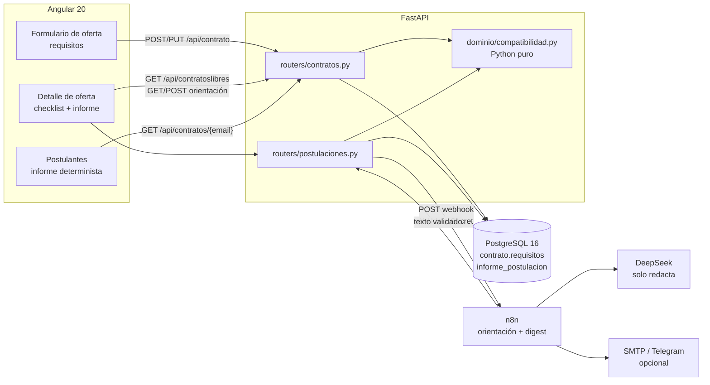
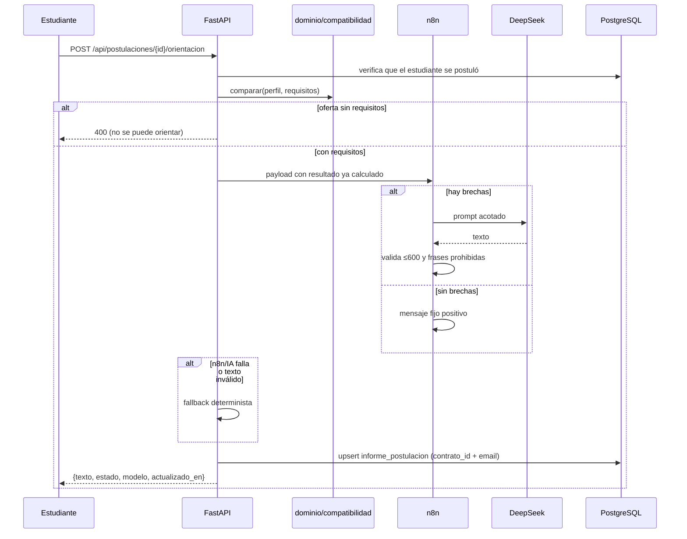
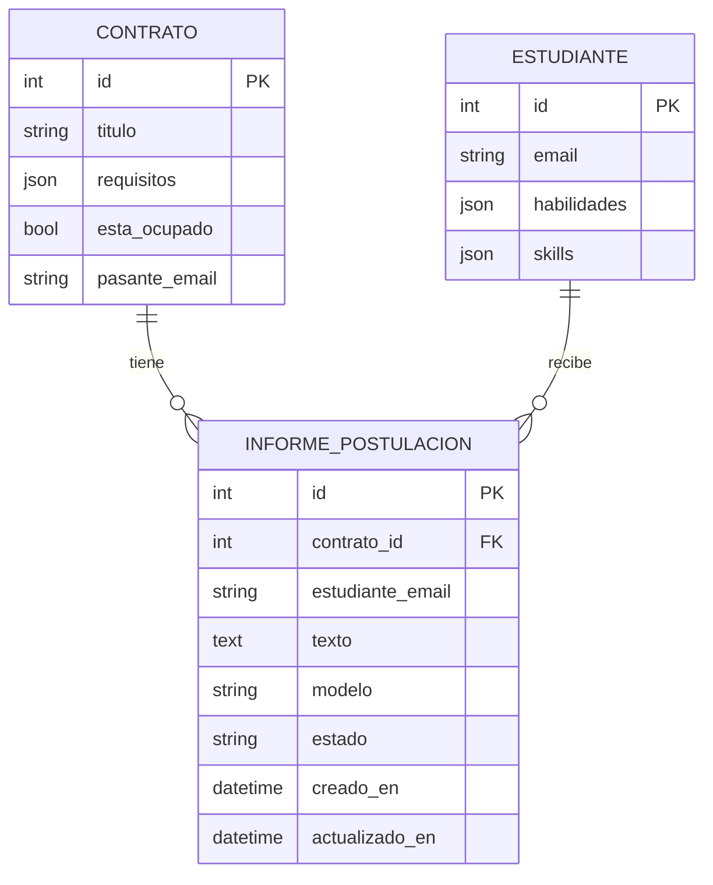

# Arquitectura — compatibilidad y orientación

> Documento de la entrega TP2. Describe los componentes que intervienen en el proceso de
> compatibilidad entre el perfil declarado de un estudiante y los requisitos de una oferta,
> y el recorrido de los datos. El cálculo es determinista; la IA es solo redacción.

## 1. Vista de componentes



**Regla de oro:** el porcentaje, las listas de compatibles y a capacitar, y el checklist
salen de `dominio/compatibilidad.py`. n8n y DeepSeek reciben ese resultado ya calculado y
nunca lo modifican.

## 2. Recorrido de datos

### 2.1 Publicación de la oferta

1. La empresa completa el formulario (`formcreatecontract`). Cada requisito tiene:
   `nombre`, `nivel_minimo` (`principiante | intermedio | avanzado`),
   `exigencia` (`excluyente | deseable | se_aprende`) y `tipo` (`tecnica | blanda`).
2. El backend normaliza y valida con `sanitizar_requisitos`: recorta nombres a 120
   caracteres, elimina duplicados, aplica valores por defecto y descarta ítems inválidos.
3. `contrato.requisitos` se guarda como JSONB en PostgreSQL (JSON en SQLite para tests).
   Una oferta sin requisitos es válida: el informe devuelve `sin_requisitos`.

### 2.2 Postulación

1. El estudiante abre una oferta libre. `GET /api/contratoslibres` agrega
   `mi_resultado = comparar(perfil, requisitos)` calculado al vuelo.
2. El botón **Postularme** nunca se deshabilita por falta de requisitos. La postulación
   solo se bloquea si la oferta ya está ocupada, como antes.
3. No se guarda un puntaje en el perfil ni en la postulación: el resultado se recalcula en
   cada consulta. Si el estudiante mejora su perfil, el indicador sube al recargar.

### 2.3 Informe determinista

`comparar(perfil, requisitos)` devuelve:

```json
{
  "coincidencia": 50,
  "nivel": "media",
  "total_requisitos": 2,
  "total_compatibles": 1,
  "sin_requisitos": false,
  "compatibles": [{"nombre": "Python", "nivel": "intermedio"}],
  "a_capacitar": [{"nombre": "SQL", "nivel_minimo": "intermedio", "motivo": "no_declarada"}],
  "se_aprenden": ["Docker"],
  "blandas": ["Comunicación"],
  "checklist": [
    {"nombre": "Python", "estado": "cumple", "nivel_minimo": "intermedio", "nivel_declarado": "intermedio"},
    {"nombre": "SQL", "estado": "falta", "nivel_minimo": "intermedio", "nivel_declarado": null}
  ],
  "requisitos_invalidos": []
}
```

Reglas del cálculo:

- Solo cuentan los requisitos **técnicos** con exigencia `excluyente` o `deseable`.
- `se_aprende` y `blanda` se listan aparte y **no** entran en el total ni en el porcentaje.
- Un requisito cuenta como compatible si el nivel declarado es mayor o igual al mínimo.
- Los niveles se normalizan: `principiante/basico = 1`, `intermedio = 2`, `avanzado = 3`,
  `experto = 4`; también acepta valores como `"B2 - Intermedio alto"`.
- Los nombres se comparan sin mayúsculas, tildes ni separadores; hay sinónimos acotados
  (`js → javascript`, `postgres → postgresql`, `powerbi → power bi`, etc.).
- Sin requisitos técnicos, `coincidencia = 0`, `nivel = "sin_requisitos"` y
  `sin_requisitos = true`; la UI muestra “La oferta no especificó requisitos”.

### 2.4 Orientación con IA y fallback



- El endpoint es **solo para el estudiante dueño de la postulación**. Otro estudiante o
  un gerente recibe `403`.
- `informe_postulacion` tiene una restricción única `(contrato_id, estudiante_email)`:
  regenerar actualiza el registro, no duplica.
- El backend valida de nuevo el texto (no vacío, ≤600, sin frases de rechazo). Si no pasa,
  guarda fallback y `estado = "fallback"`.
- n8n es opcional: si `N8N_ORIENTACION_WEBHOOK_URL` está vacío o el webhook falla, la
  orientación se genera igual con el texto determinista.

### 2.5 Vista de la empresa

`GET /api/contratos/{email_gerente}` agrega `resultados_postulantes` **solo si el token
pertenece al gerente dueño** de esas ofertas. Cada elemento contiene email, nombre y el
resultado determinista. La empresa **no recibe** el texto de orientación de IA.

El modal de asignación muestra el informe del postulante seleccionado, pero no ordena ni
deshabilita la asignación: la decisión sigue siendo de la empresa.

### 2.6 Digest semanal

`GET /api/automatizacion/digests` (protegido con `X-Udela-Secret`) recorre estudiantes,
busca ofertas libres a las que no se postularon, calcula `comparar`, se queda con las 3 de
mayor coincidencia que superen 60 % y devuelve hasta 3 por estudiante. El workflow de n8n
prepara un mensaje por estudiante y, si hay SMTP configurado, lo envía. No hay ranking de
personas: solo se ordenan ofertas para una misma persona.

## 3. Modelo de datos



- `contrato.requisitos` es una lista JSON. No se creó una tabla de requisitos para no
  romper el contrato actual de la API y mantener el seed simple.
- `informe_postulacion.estado` puede ser `pendiente`, `generado` o `fallback`.
- `modelo` guarda `deepseek-flash`, `n8n`, `fallback` o `sin-brechas` según el origen. `estado` es `generado` solo si el texto lo escribió la IA: con `fallback` o `sin-brechas` (textos deterministas de n8n) el backend guarda `estado: "fallback"`.
- El backend vuelve a validar el texto: no vacío, hasta 600 caracteres, sin frases de rechazo y terminado en `.`, `!`, `?` o `…` (con comillas o paréntesis opcionales). Un texto cortado por el límite de tokens no cumple lo último y se reemplaza por el fallback.
- No se agregan columnas de edad, género, nacionalidad ni puntajes acumulados.

## 4. Seguridad y privacidad

- Todos los endpoints de informe/orientación exigen JWT (`get_current_user`).
- La orientación se autoriza por pertenencia a `contrato.postulaciones`, no por un email
  recibido en el body.
- Los endpoints de automatización exigen `X-Udela-Secret` y comparan con
  `hmac.compare_digest`; si el secreto no está configurado responden `503`.
- El payload que va a n8n no incluye teléfono, fecha de nacimiento, género, DNI ni
  descripción libre del perfil: solo nombre de la oferta, listas de habilidades y
  coincidencia.
- La empresa nunca recibe el texto de IA ni datos sensibles.
- Los workflows versionados no contienen secretos: solo referencian credenciales de n8n.

## 5. Modos de falla

| Falla | Comportamiento |
|---|---|
| n8n apagado o sin URL | `POST orientación` guarda fallback; el informe determinista funciona |
| DeepSeek devuelve error | Validar/fallback en n8n; el backend guarda fallback si la respuesta no llega |
| Texto > 600 o con frases de rechazo | n8n usa Fallback; el backend también rechaza y usa fallback |
| Oferta sin requisitos | `sin_requisitos = true`; no se genera orientación (400 explicativo) |
| Perfil sin habilidades | 0 %; todo “a capacitar”; la postulación se registra igual |
| Migración no aplicada | `alembic upgrade head`; `alembic check` no debe detectar cambios |
| Seed ejecutado dos veces | No duplica ofertas ni usuarios (idempotente) |

## 6. Decisiones de diseño

1. **Python puro en el dominio.** Sin dependencias externas, testeable y explicable.
2. **Resultado al vuelo.** No se persiste el porcentaje: se evita un dato que envejece y
   se garantiza que el informe refleje el perfil actual.
3. **Requisitos en JSONB.** Menos migraciones y compatibilidad con el contrato existente.
4. **Un registro de orientación por postulación.** Unique constraint + upsert.
5. **Doble validación del texto.** n8n valida y el backend vuelve a validar; defensa en
   profundidad.
6. **La IA no participa del cálculo ni de la decisión.** Solo redacta a partir de datos
   estructurados.
7. **La empresa ve el informe determinista, no la orientación.** Evita usar el texto de IA
   como filtro de selección.
8. **Sin ranking y sin bloqueo.** Se mantiene el orden original de las ofertas y el botón
   de postulación siempre disponible mientras la oferta esté libre.
